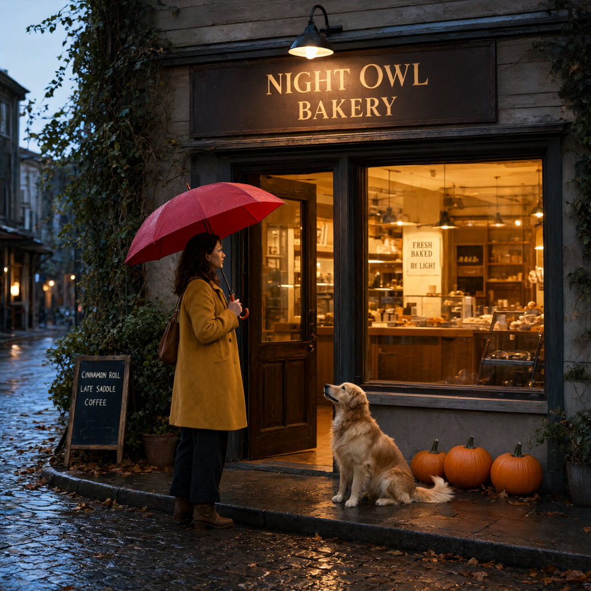
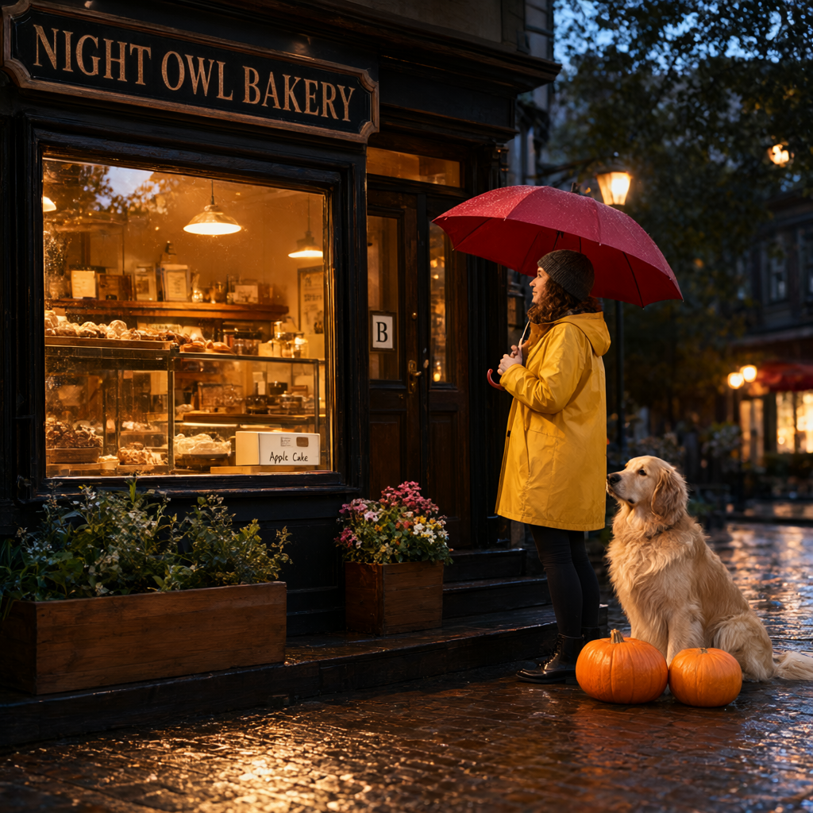

# Qwen-Image-2.1: BF16 versus Q8

Measured on 2026-10-16 on an **Apple M5 Max MacBook Pro with 64 GiB unified memory**.

| Measured outcome | BF16 | Q8 |
|---|---:|---:|
| Complete PE-T2I → 40-step image | 161.65 s | 128.38 s |
| PE-T2I job | 71.12 s | 40.34 s |
| Image job | 90.53 s | 88.04 s |
| Image peak MLX allocation | 32.43 GB | 22.94 GB |

Q8 used less memory and finished the complete pipeline **20.6% sooner** in this sample. BF16 preserved the requested subject placement and three pumpkins; Q8's enhancer changed the placement, and its image shows only two pumpkins. Both checkpoints passed the quantization audit and completed all 40 steps.

## Test setup

One complete end-to-end run per suite: its own PE-T2I enhancer rewrites the same source prompt, then its own image model generates from that rewrite. **1024 × 1024, 40 steps, seed 20261016**, no input images, no LoRA, no art-style suffix, opaque output. The app's standard Euler linear scheduler and guidance 1.0 are used. Both suites use the same memory settings: text-encoder offload enabled and VAE tiling disabled.

PE settings: English, thinking enabled, maximum 8,192 new tokens, temperature 1.0, top-p 0.95, top-k 20. Sampling is seeded **after loading** with 314159 for both runs. Rewrites may still differ because model precision changes token probabilities. This compares complete pipelines; it does **not** isolate the image transformer's quantization from prompt-enhancer changes.

Each suite runs in a separate fresh Python process, with no other ImageAtelier server running, using the real ImageAtelier engine and downloaded local models. No downloads or conversion time are included. This is a single-run comparison, not a statistical benchmark. Filesystem cache, kernel compilation, power/thermal state, and background desktop activity are not fully controlled. BF16 ran first. An earlier BF16 PE initialization was aborted while fixing seed placement; it is excluded from all measurements and may have warmed the filesystem cache. GPU stage boundaries are synchronized. Instrumentation and file persistence add a small amount of overhead.

Software: mlx 0.32.3, mlx-vlm 0.7.4, mflux 0.20.0, huggingface_hub 1.33.0.

### Shared source prompt

> An editorial photograph of a small neighborhood bakery at blue hour after rain. A woman in a mustard-yellow coat stands on the left holding a red umbrella; a friendly golden retriever sits on the right beside exactly three orange pumpkins. Warm light spills through the window. Above the door, a sign clearly reads "NIGHT OWL BAKERY". Wet cobblestones reflect the amber lights. Natural proportions, detailed textures, cinematic yet realistic lighting.

## Generated images

### BF16



### Q8



## Stage timings

All values are seconds. A ratio above 1 means Q8 was faster. Bold rows are independently measured wall-clock totals; they include scheduling/polling overhead and are not additional stages to sum again. Model loading includes materialization of the respective checkpoint weights. The image-load row also loads the text/vision encoder and VAE. The separate image overhead row includes PE unloading during the model transition, runtime-format auditing, PNG serialization, and Python bookkeeping.

| Stage | BF16 (s) | Q8 (s) | BF16 ÷ Q8 |
|---|---:|---:|---:|
| PE-T2I model load | 1.421 | 1.395 | 1.02× |
| PE prefill → first token | 0.962 | 1.094 | 0.88× |
| PE thinking-token decode | 28.599 | 17.188 | 1.66× |
| PE answer-token decode | 37.555 | 17.876 | 2.10× |
| PE template/setup/other overhead | 0.029 | 0.029 | 1.00× |
| PE GPU synchronization and cleanup | 0.051 | 0.048 | 1.06× |
| PE worker startup, imports, idle guard and polling | 2.500 | 2.713 | 0.92× |
| **PE job wall time** | 71.117 | 40.342 | 1.76× |
| Image model load (transformer + text/vision encoder + VAE) | 4.802 | 1.733 | 2.77× |
| Image prompt encoding | 2.569 | 0.463 | 5.55× |
| Text-encoder offload | 0.200 | 0.074 | 2.70× |
| 40 denoising steps | 79.261 | 82.898 | 0.96× |
| VAE decode + pixels | 2.787 | 1.963 | 1.42× |
| Image setup, model transition, PNG save and other overhead | 0.192 | 0.190 | 1.01× |
| Image GPU synchronization and cleanup | 0.042 | 0.041 | 1.02× |
| Image idle guard and polling | 0.681 | 0.680 | 1.00× |
| **Image job wall time** | 90.534 | 88.041 | 1.03× |
| **Complete PE → image wall time** | 161.651 | 128.384 | 1.26× |

PE thinking decode starts after the first emitted token and ends when `</think>` appears; prefill includes producing the first token. PE answer decode includes the final JSON answer. VAE decode includes latent unpacking and conversion to image pixels. Peak allocation means MLX's recorded peak, not total macOS RAM usage.

| Metric | BF16 | Q8 |
|---|---:|---:|
| PE thinking tokens | 919 | 965 |
| PE answer tokens | 1207 | 988 |
| PE decode throughput (tokens/s) | 32.1 | 55.7 |
| PE peak MLX allocation (GB) | 20.634 | 12.116 |
| Image peak MLX allocation (GB) | 32.432 | 22.939 |
| Mean denoising step (s) | 1.982 | 2.072 |
| First denoising step (s) | 3.279 | 2.237 |
| Mean steps 2–40 (s) | 1.948 | 2.068 |

## Quantization verification

The five weight components total **70.755 GB** in the original suite and **38.641 GB** in the converted suite, a **45.4%** reduction (decimal GB; processor/config files excluded).

| Component | Source weights (GB) | Q8 weights (GB) | Q8 packed matrices checked | Mean sampled relative RMS error |
|---|---:|---:|---:|---:|
| transformer | 14.230 | 7.655 | 228 | 0.726% |
| text_encoder | 17.534 | 8.782 | 343 | 0.729% |
| vae | 1.351 | 1.351 | 0 | Full precision retained |
| t2i | 18.820 | 10.427 | 250 | 0.738% |
| i2i | 18.820 | 10.427 | 250 | 0.738% |

Checkpoint checks covered all packed matrices: shape, unsigned 32-bit packing containing four 8-bit values per word, scale/bias shapes, and group size 64. Every source vision tensor was accounted for, including the convolution layout change required by MLX. The numerical audit dequantized the first and middle rows of every packed matrix and compared those values with the corresponding BF16 source rows. This is a sampled numerical check, not a full-tensor equality test; Q8 is lossy by design.

The image transformer and eligible text/vision encoder layers are Q8; **90 vision layers** in the image encoder are quantized. PE-T2I and PE-I2I have Q8 language-model layers, while **their vision towers remain BF16 under the MLX-VLM converter's policy**. The reference convolutional **VAE remains F32 in both suites**. Thus “Q8 suite” does not mean every tensor uses eight bits. BF16 runtime models were checked for the absence of quantized modules; Q8 runtime image/PE-T2I models were checked for 8-bit modules with group size 64. PE-I2I was audited on disk but was not used for this text-to-image benchmark.

## RAM budget and Q6/Q4 estimates

Using a conservative **6 GB allowance for macOS and other apps**, these are the recommendations for this workload, with text-encoder offload enabled and **VAE tiling disabled**:

| Suite | Peak model memory | With 6 GB overhead | Recommended RAM | Evidence |
|---|---:|---:|---:|---|
| BF16 | 32.4 GB | 38.4 GB | 48 GB | Measured |
| Q8 | 22.9 GB | 28.9 GB | 32 GB | Measured |
| Q6 | 21.2 GB | 27.2 GB | 32 GB | Estimated |
| Q4 | 19.4 GB | 25.4 GB | 32 GB | Estimated |

The Q8 decoding peak is the limiting stage. Its transformer contains 7.013 GB of packed 8-bit matrix data. Assuming unchanged activations, full-precision VAE, and group-64 scale/bias storage, Q6 saves another 25% of those packed bytes and Q4 saves 50%. Their estimated peaks therefore subtract those savings from the measured Q8 decoding peak; they do not scale all memory linearly with bit depth. The text encoder is already offloaded by this stage. Neither lower-bit peak has been measured here.

The app recommends BF16 at **48 GB RAM or more**, Q8 at **32–47 GB**, and no suite below 32 GB under this headroom policy. Q6 and Q4 remain available as manual choices. For a conservative 24 GB target, the model budget would be 18 GB; Q6 would need about 3.2 GB of additional peak savings and Q4 about 1.4 GB. VAE tiling is a candidate for achieving those savings, but requires a separate measurement before a 24 GB recommendation. Measured allocations use decimal GB; physical RAM thresholds use the Mac's GiB capacity tiers, with conservative rounding for the recommendation.

## Analysis

### Speed and memory

The Q8 pipeline finished in **128.38 s (2 min 8 s)** versus **161.65 s (2 min 42 s)** for BF16: **33.27 seconds saved, 20.6% less elapsed time, or 1.26× throughput** for this one complete run. Most of the gain came from PE-T2I: its wall time fell from 71.12 to 40.34 seconds. The measured image-job saving was much smaller, 90.53 to 88.04 seconds, or 2.8%.

PE decoding ran at **55.7 tokens/s for Q8 versus 32.1 tokens/s for BF16**. Q8 generated 965 thinking tokens and 988 answer tokens; BF16 generated 919 thinking tokens and 1,207 answer tokens. Q8 therefore both decoded faster and wrote a shorter answer. The shorter answer contributes to its elapsed-time advantage; the 43.3% PE wall-time reduction is not a comparison at identical output length. The shared 70-word input expanded to 951 words under BF16 and 763 under Q8.

Q8 did **not** accelerate every stage. Its 40 denoising steps took **82.90 s versus 79.26 s**, about **4.6% longer**. Its smaller image checkpoint loaded faster (1.73 versus 4.80 seconds), and its shorter enhanced prompt encoded faster (0.46 versus 2.57 seconds), largely offsetting that denoising slowdown. These timings establish what happened on this M5 Max in these runs; they do not isolate kernel performance from prompt length, compilation, cache, or thermal effects. The VAE also timed differently despite retaining identical F32 precision, illustrating why a single-run stage difference should not automatically be credited to quantization.

Image-job peak MLX allocation fell from **32.43 GB to 22.94 GB**, a **29.3% reduction**. BF16 peaked during prompt encoding; Q8 peaked during VAE decoding. PE peak allocation fell from **20.63 GB to 12.12 GB**, a **41.3% reduction**. The shared full-precision VAE and activation buffers help explain why image peak memory did not fall as much as checkpoint size. Offloading the text encoder after encoding was enabled for both runs.

### Prompt fidelity and visible results

| Requested property | BF16 result | Q8 result |
|---|---|---|
| “NIGHT OWL BAKERY” signage | All three words are clearly legible, arranged across two lines. | All three words are legible on a single sign; spacing is tighter. |
| Woman on the left; dog on the right | Preserved: woman left of center, retriever to her right. | Woman and dog are both on the right; the requested placement of the woman was lost. |
| Mustard coat and red umbrella | Both present. | Both present; a knit beanie was also added by the enhancer. |
| Exactly three orange pumpkins | Three distinct pumpkins are visible beside the dog. | Only two distinct pumpkins are visible in front of the dog. |
| Rainy blue hour, amber interior, wet cobblestones | Coherent cool street/warm interior contrast, wet paving, detailed reflections. | Coherent cool dusk/warm interior contrast, strong golden paving reflections and window moisture. |
| Photographic appearance | Convincing cloth, wood, foliage and fur textures; a wider street-side composition. | Convincing raincoat, fur, rain and storefront textures; a tighter composition with a larger dog and stronger bokeh. |

Both outputs are coherent, detailed, photo-like images, with plausible umbrella handling, shop lighting and wet-surface reflections. I do not see a gross corruption failure such as noise, broken decoding, or widespread malformed objects. For this particular source prompt, **BF16 was more faithful to the layout and count constraints**. That is a constraint-following observation from one scene, not a general quality ranking across prompts.

The position error is already explicit in the **Q8 enhanced prompt**: “On the right side of the storefront, an adult woman stands…”. Its image follows that changed instruction. The BF16 enhancer instead says “slightly left of center,” which preserves the source placement. The Q8 pumpkin omission is different: its enhancer still explicitly requests exactly three, so the final image fails a constraint that remained in its input. These are two distinct failure locations in the pipeline.

Both enhancers also invented secondary text and decorative details. BF16 added “FRESH BAKED”, “BY LIGHT” and the odd menu item “LATE SADDLE”; the generated image reproduces those additions. Q8 added “Apple Cake” and a door label “B”, which also appear in its image. Extra signs, planters, clothing details and architectural choices make the scenes richer, but weaken strict fidelity to the original short prompt. When exact composition or wording matters, reviewing the enhanced prompt before generating would catch some of these changes.

### What this comparison supports

**Q8 worked correctly as a quantized model and delivered substantial memory savings plus a faster complete PE-to-image pipeline. BF16 preserved more of this prompt's requested constraints.** The measured Q8 denoising slowdown means reduced checkpoint size should not be treated as a guarantee of faster image sampling on this hardware.

Quantized weights change token probabilities; even with the same PE sampling seed, the enhancers produced different text. The generated images therefore reflect both enhancer divergence and image-model precision. A clean test of the image model alone would feed both image suites one identical, fixed enhanced prompt and repeat several seeds/runs. The current images answer the requested complete-pipeline comparison. No image-reference/I2I generation was performed, and the numerical weight errors reported above are not perceptual image-quality scores.


## Full enhanced prompts

### BF16 PE-T2I

The image shows a cinematic, realistic street-side bakery exterior at dusk or early evening after rain, with a warm amber storefront glow contrasting against a cool blue-gray outdoor environment. Across the upper center of the old wooden facade is a large horizontal dark brown wooden sign with a matte, weathered surface and gold serif lettering. The main storefront text reads "NIGHT OWL" on the top line and "BAKERY" on the lower line, functioning as the primary business sign. The lettering appears slightly worn and softly illuminated by a wall-mounted black metal gooseneck lamp directly above the sign. The lamp has a bell-shaped shade with a warm bulb underneath, casting a focused cone of golden light downward onto the sign and doorway. Surrounding the sign are horizontal wooden siding boards in muted gray-brown tones, with visible grain, seams, weathering, and rain-darkened edges. On the upper-left and mid-left areas, ivy and leafy vines climb along the building wall, adding irregular green foliage and dark plant shadows to the scene.

Below the sign, the bakery entrance is centered slightly left of the image midpoint. A dark wooden door with glass panels stands open inward, creating a doorway into the warmly lit interior. The door has rectangular carved panels, dark metal hardware, and reflective glass sections that catch the amber light from inside. The threshold and stone or concrete step at the base of the doorway are damp and textured. Inside the bakery, visible through the open doorway and large right-side window, are shelves, wooden counter surfaces, glass display cases, cups, pastries or baked goods, and warm pendant or track lighting. A small hanging poster or chalk-style sign inside the window area reads "FRESH BAKED" on the upper line and "BY LIGHT" below it in dark serif letters on a light cream background. The interior light is golden and inviting, with reflections on glass and polished surfaces.

On the left side of the entrance, a small sidewalk chalkboard sign leans against the wall near low greenery. It has a dark black writing surface in a wooden A-frame. The visible chalk-style handwritten text appears as menu items reading "CINNAMON ROLL", "LATE SADDLE", and "COFFEE" in light cream lettering, arranged vertically from top to bottom. Behind and around the sign are dense shrubs, vines, fallen leaves, and wet plant textures. The left background shows a narrow street or alley receding into the distance, lined with dim storefronts and old facades. The road surface is wet, dark, and reflective, with small highlights from distant streetlights and shop windows.

In front of the bakery entrance, slightly left of center, stands a single adult woman holding a red umbrella. She appears to be a woman in her 30s or 40s with light to medium skin tone, average height and build, and medium-length dark brown wavy hair. She is shown in side profile facing right toward the bakery door, with a calm, attentive expression as if about to enter. Her face is partially lit by the warm interior light and the lamp above the sign, creating soft highlights on her cheek and forehead. She wears a mustard-yellow wool coat with a mid-length cut, dark loose trousers, brown ankle boots, and a brown shoulder bag hanging from her left shoulder. She holds the red umbrella handle with one hand; the umbrella is open above her, occupying the upper-left-central portion of the frame. Its canopy is dark red with visible rib lines, a curved handle, and wet reflective surfaces from the rain. The umbrella visually overlaps the bakery sign area and adds a strong warm color accent against the cool rainy environment.

To the right of the entrance, beneath the large right-side window, a golden retriever sits on the wet stone sidewalk. The dog is medium-to-large, with golden fur, a feathered tail curled around its body, and a relaxed seated posture. Its head is turned slightly upward and left, looking toward the open doorway and the woman, with an attentive, gentle expression. The dog’s fur catches the warm amber light from the bakery, while cooler blue shadows define the rain-soaked street behind it.

The right half of the storefront is dominated by a large rectangular window with dark wooden framing. Through the glass, the warmly lit bakery interior is visible in soft focus: wooden shelves, a counter, cups or containers, glassware, baked goods, and reflections of exterior lights. The window surface shows subtle rain and reflection effects, with warm highlights from inside and cooler bluish reflections from outside. Below and near the window, three orange pumpkins sit together on the wet sidewalk at the lower-right area of the image. They vary slightly in size and shape, with rounded forms, ribbed surfaces, dark green-brown stems, and glossy highlights from the rain. Their saturated orange color contrasts with the muted gray stone pavement and the amber bakery light. Scattered brown leaves lie around the pumpkins and along the curb.

The foreground pavement consists of dark cobblestones or irregular stone paving, heavily wet and reflective. The stones show varied tones of charcoal, gray, brown, and copper, with bright golden reflections from the lamp and interior bakery lights. A raised stone border runs along the storefront edge, forming a curb and threshold that leads the eye toward the open door. Fallen leaves are scattered across the sidewalk and street, especially near the lower-right and left edges. The overall composition uses a low-to-eye-level street photography perspective with shallow depth of field: the woman, doorway, dog, pumpkins, and sign are the primary focal elements, while the alley and distant lights blur into warm bokeh. The image has a cozy autumn-evening atmosphere, emphasizing rain, warm bakery light, old wood textures, reflective pavement, and seasonal details such as pumpkins and leaves.

### Q8 PE-T2I

A warm, cinematic street-level photograph shows the exterior of a small independent bakery at dusk or early evening after rain. Across the upper-left portion of the storefront, a large rectangular wooden-framed sign with a dark black-brown background and aged tan lettering reads "NIGHT OWL BAKERY" in prominent serif capitals. The sign has an ornate, slightly weathered border with curved decorative corners, mounted above the window and door on a dark, textured building façade. Warm amber light from the bakery interior spills outward, contrasting with the cool blue outdoor dusk tones. Behind and above the sign, the background contains softly blurred trees, shadowed building details, and small round streetlights, creating a shallow-depth-of-field bokeh effect.

Below the sign, the storefront is framed in dark, worn wood and black metal trim. A large rectangular display window occupies the left-center area, bordered by black painted wood with visible grain, scratches, and glossy rain-darkened edges. Inside the bakery, shelves and counter areas glow with golden pendant lighting. Several breads, pastries, jars, boxes, framed items, and small menu-like papers are visible on the back shelves, though the tiny internal labels are too blurred to read clearly. A hanging pendant lamp with a warm cream-colored shade is visible near the upper center-left inside the shop, with another smaller warm light farther right. Near the lower-right portion of the window, a pale cake or display box bears the handwritten-style label "Apple Cake" in dark text. The window glass is slightly reflective and speckled with moisture, showing reflections of trees, warm lights, and the rainy street.

To the right of the window is a dark wooden bakery door with vertical panels, black-painted framing, glass panes, and a brass-colored handle. A small square sign or glass label on the door contains the letter "B" in a dark serif character on a pale background. Above and beside the doorway, decorative molding and trim add an old-fashioned neighborhood-bakery character. At the lower-left side of the storefront, a large rectangular wooden planter sits on the wet sidewalk, filled with green leafy plants and small pale flowers. The planter has a weathered brown surface and aligns with the bakery’s rustic, vintage aesthetic. Near the door, a smaller wooden planter holds clustered pink, white, and yellow flowers, placed on or beside the step leading into the bakery. The steps are dark, wet wood, with glossy highlights from rain and warm shop light.

On the right side of the storefront, an adult woman stands in three-quarter profile facing toward the bakery door and window. She appears to be in her 30s or 40s, with a slim-to-average build, light-to-medium skin tone, and medium-length curly brown hair falling around her face. Her face is partially visible in profile, with a calm, reflective expression as she looks toward the warmly lit entrance. She wears a mustard-yellow raincoat with a matte, slightly wrinkled texture, a dark gray knit beanie, dark leggings or slim pants, and black ankle boots with a polished finish. She holds a red umbrella above and slightly behind herself; the umbrella is open, medium-large, semicircular in silhouette, with visible ribs and wet raindrops catching the warm light along its dark red petal edges. The umbrella overlaps the warm window light and dark storefront, forming a strong visual shape against the cozy interior glow.

A golden retriever sits beside exactly three orange pumpkins at the right edge of the image, positioned near the woman and the bakery steps. The dog is large, golden-colored, and fluffy, with soft feathering around the ears, chest, and legs. Its head is turned slightly to the left, looking toward the woman and the bakery, and its expression appears gentle and attentive. Three round orange pumpkins sit on the wet pavement in front of the dog, clustered together near the woman’s feet. Their surfaces are matte, ribbed, and warmly lit, with bright orange highlights and darker shadowed grooves.

The ground across the foreground is made of wet cobblestones or brick pavers, with irregular rectangular shapes and glossy reflections. The warm amber light from the bakery window stretches across the pavement in shimmering streaks, while cooler blue-gray shadows suggest rain-soaked evening air. On the far right background, more warm streetlights and storefront lights appear as blurred circular glows against dark trees and architecture. The overall composition is balanced between the bakery sign and window on the left and the woman, dog, umbrella, and pumpkins on the right. The image has a realistic photographic style with cinematic color grading, shallow depth of field, rich contrast between warm interior light and cool rainy exterior tones, and a cozy autumn atmosphere.

## Reproducibility and raw results

- [BF16 measurements](benchmarks/qwen-bf16-vs-q8/bf16.json)
- [Q8 measurements](benchmarks/qwen-bf16-vs-q8/q8.json)
- [Checkpoint numerical audit](benchmarks/qwen-bf16-vs-q8/quantization-audit.json)
- [Benchmark runner](benchmarks/qwen-bf16-vs-q8/run_benchmark.py)
- [Audit script](benchmarks/qwen-bf16-vs-q8/audit_quantization.py)

From the repository root, run the audit and then each suite sequentially (these commands replace the corresponding benchmark outputs):

```sh
HF_HUB_OFFLINE=1 .venv/bin/python benchmarks/qwen-bf16-vs-q8/audit_quantization.py
caffeinate -i .venv/bin/python benchmarks/qwen-bf16-vs-q8/run_benchmark.py bf16
caffeinate -i .venv/bin/python benchmarks/qwen-bf16-vs-q8/run_benchmark.py q8
.venv/bin/python benchmarks/qwen-bf16-vs-q8/make_report.py
```

Pinned repository revisions are recorded in the numerical audit. Logs and per-step timings are stored alongside the images. Enhanced prompts are also saved separately as plain text.
